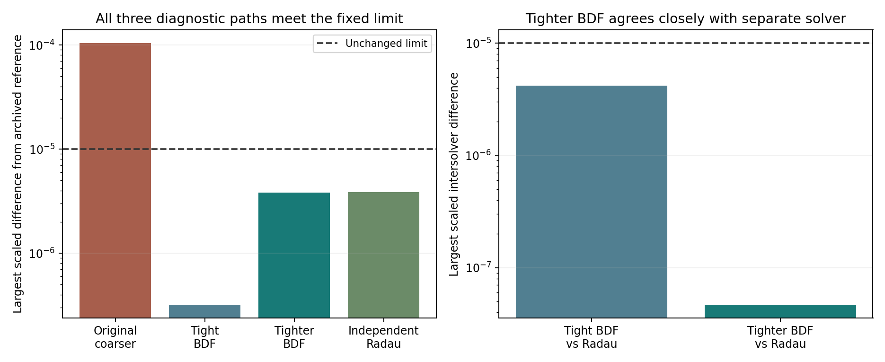

# H3b isolated-control tolerance diagnostic — MG119

The tighter-tolerance check supports the explanation that the isolated-control failure was numerical rather than a change in Model G behavior. With the physical model, starting fields and accuracy threshold unchanged, both tighter BDF calculations and a separately assembled Radau calculation met the registered limit. The tightest BDF and Radau solutions agreed much more closely with one another than either agreed with the archived reference, showing why that reference should be treated as a finite-accuracy calculation rather than exact truth. This resolves the targeted numerical concern within the diagnostic scope; it does not complete or retrospectively pass the original stopped batch, and it does not establish stochastic particle behavior or new geometry.

**Diagnostic outcome: TOLERANCE EXPLANATION SUPPORTED IN TESTED ISOLATED CONTROL. Original MG117 study: failed/incomplete, unchanged.**

All three separately registered diagnostic integrations completed, with all 101 quarter-unit frames retained and the saved-data checks passed. No retry, changed threshold, altered physical parameter or replacement of an original trajectory occurred.

## What was held fixed

The failed case was the isolated, seeded finite-reservoir control on the 500-site ring. This diagnostic used the same initial seven-species fields, original A/B reference denominators, diffusion, zero A/B hopping, equations, T0–25 horizon, output grid and closed archived fine reference. There was no RNG, new particle preparation, resource regeneration or change in physics.

The original criterion was preserved: max-over-species/site/time difference divided by max(1, the species' maximum initial concentration) must be <=1e-5. Initially zero Z/W still use divisor1; there was no favorable final-Z rescaling. The original coarse failed error remains **0.000104192675281**.

## Registered comparisons

| New diagnostic | Relative tolerance | Absolute tolerance | Max step | Largest scaled error vs archive | Result |
|---|---:|---:|---:|---:|---|
| bdf_tight | 1e-11 | 1e-13 | 0.05 | 3.20166691381e-07 | PASS |
| bdf_tighter | 1e-12 | 1e-14 | 0.025 | 3.82682446798e-06 | PASS |
| radau_reference | 1e-12 | 1e-14 | 0.025 | 3.84454142477e-06 | PASS |

| Pair | Largest scaled difference | Same 1e-5 criterion |
|---|---:|---|
| bdf_tight vs bdf_tighter | 4.14493297285e-06 | PASS |
| bdf_tight vs radau_reference | 4.16265174863e-06 | PASS |
| bdf_tighter vs radau_reference | 4.67589416075e-08 | PASS |

All three reference comparisons and all three pairwise comparisons passed. Largest relative population-balance residual was **8.54140859962e-16**; all fields were finite and nonnegative. No output was clipped or normalized to hide a discrepancy.

The incidence BDF paths used the existing nine-field population/import RHS. Radau used the separately assembled seven-species reaction/diffusion RHS and its separate Jacobian structure from the frozen oracle code, appending zero imports only for saving the closed trajectory. Initial equations were cross-checked at original saved states T0,12.5,25 within the frozen tolerance. Shared physical inputs and SciPy dependencies remain; this is same-author separate equation assembly/solver evidence, not external replication.

## Why tighter is not always closer to the old archive

The first tight BDF result is closest to the archived solution: about **3.2e-07** away. But the tighter BDF and Radau are each about **3.8e-6** from the archive while agreeing with each other to **4.67589416075e-08**. Their largest mutual difference is far below the unchanged1e-5limit.

This is consistent with a shared high-accuracy solution and residual error in the old finite-tolerance reference. A solution can be closer to an imperfect reference without being closer to the exact differential-equation solution. We did not select the first setting because its archive error was smaller, and do not require monotonic improvement against that archive. This is numerical convergence evidence, not a rigorous exact-solution error certificate.

The original large discrepancy was concentrated in accumulated Z. Very small integration differences in a growing output can exceed an absolute error requirement even while active fields and global balances remain close. The new independent-solver agreement supports that diagnosis in this isolated control; it does not prove every possible future mismatch is numerical or validate arbitrary populations/horizons.

## Execution and preservation

Richard authorized “Go ahead with the tighter tolerance check.” The MG118 protocol, three fixed solver settings, original/reference/source hashes and300-second single-worker cap were published before integration. All original23raw trajectories, failed output, ledger, traceback and stopped evaluation are hash-unchanged. Original missing fine isolated job remains unstarted in the original experiment; the new bdf_tight path is separately labeled diagnostic evidence, not a silent completion of that job.

One local worker, numerical-library thread1, completed the three integrations, prefix IO and automatic saved-array audit in **17.832830 seconds**, below300seconds. Finished **2026-11-10T02:35:07.965412+00:00** UTC. There were no failures, retries, unplanned extra integrations or changed criteria. All101frames per method, metadata, settings, source/old-evidence provenance, comparisons and report/figure are publicly retained. See raw_manifest.json and retention_verified.json for audited hashes and publication verification.

## What should happen next

This diagnostic supports using tighter numerical integration in a prospectively defined follow-up. It does **not** change the original MG117 registered failure, make its original coarse trajectory pass, complete its unstarted job, or qualify H3 as a whole. A continuation/replacement plan must explicitly identify what validated prior evidence is reused, which new trajectories are required, the fixed accuracy/refinement criteria and the compute cap before further runs. The original stopped record remains visible.

Finite-tick mixed-law statistical qualification, an efficient identity-equivalent stochastic representation, meaningful noisy-pattern precision and higher-arity/3D particle tests remain separate H3 tasks. No further integration was launched by this report.

Publication verified: all diagnostic binaries, metadata and report match their published contents at 6e51dd7, with original/source/reference hashes unchanged. See retention_verified.json. The original stopped study remains unchanged.
