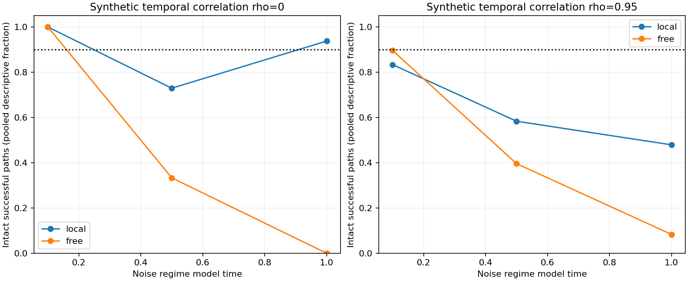

# MG169 - X/Y tracking feasibility

A bounded tracker can recover ordinary-strength X/Y cores much more effectively than the free-ring detector in several tested conditions, confirming that motion constraints can reduce the search problem. It succeeds on every early uncorrelated intact path and rejects all early uncorrelated damage/no-core cases. However, it fails the full feasibility screen: temporally correlated noise loses intact tracks, while later displaced-Y and competing-core cases often continue despite ambiguity. Tracking is therefore a promising direction with demonstrated partial gains, not a qualified persistence instrument. G remains unresolved, MG163 is not rescored, and no new Model G simulations were run.

## Frozen tracker and denominator

Every path receives the same kind of initial position/width seed, including no-core controls. No true geometry is supplied afterward. The local tracker searches within 2 sites and one 0.125 width increment of the last accepted state, width bounds 0.5-2. A failed observation holds state; three consecutive failures stop permanently, without reacquisition or expanding uncertainty. These are hard motion assumptions, not statistical confidence bounds. The jump control intentionally violates the permitted motion.

The new local per-frame thresholds are calibration maxima from 256 null and 256 single-core examples in each old noise regime. The free comparator uses the old MG167 free detector/thresholds with the same stop rule. Thus this compares whole procedures, not just the displacement bound. The full 3x3 cross-spectrum generator supplies only the X/Y channels; G is not measured. Noise regimes 0.1/0.5/1 label fixed estimated background conditions, not a simulated evolution from one regime to the next.

Tests use 40 observations/path, spacing 0.001 model time, 16 independent synthetic noise sequences per case in each of 3 regimes and 2 temporal conditions (rho 0 or 0.95). Temporal AR1 is prescribed, not measured from Model G; correlations at fixed sites interact with motion. Positives are amplitude 1 static, moving 1 site/observation, or moving/deforming with width 1->1.125->1.25->1.125. Negative cases are absent from start, or vanish/removeX/removeY/displaceY/addsecondcore/jump 20 sites at frame 10. Seed 16900/source/input hashes were published and push completion confirmed before draws.

## Intact-path success

A successful intact path must stay alive through all 40 observations, have >=36 compatible frames, and have >=36 live estimates within 2 sites and 0.125 width of injected truth. Gaps are not compatible observations. Require at least 15/16 successful paths percase; not a population reliability bound.

| Noise regime | rho | Static local/free | Moving local/free | Deforming local/free |
|---|---:|---:|---:|---:|
| 0.1 | 0 | 16/16 / 16/16 | 16/16 / 16/16 | 16/16 / 16/16 |
| 0.1 | 0.95 | 12/16 / 13/16 | 13/16 / 15/16 | 15/16 / 15/16 |
| 0.5 | 0 | 11/16 / 1/16 | 9/16 / 5/16 | 15/16 / 10/16 |
| 0.5 | 0.95 | 14/16 / 9/16 | 5/16 / 2/16 | 9/16 / 8/16 |
| 1 | 0 | 15/16 / 0/16 | 14/16 / 0/16 | 16/16 / 0/16 |
| 1 | 0.95 | 9/16 / 4/16 | 5/16 / 0/16 | 9/16 / 0/16 |

At late uncorrelated noise, local tracking succeeds on 15/16 static, 14/16 moving and 16/16 deforming paths, compared with 0/16 for each free procedure. The moving case still misses the 15/16 criterion. Correlated-noise performance is weaker and inconsistent across regimes, so the success in independent-noise conditions cannot be generalized. Pooled fractions in the figure are descriptive only; the frozen gate applies separately to each case.

## False continuation after damage or absent cores

The tracker must stop by onset+5 observations (by frame 5 for absent controls, 15 for other negatives). False continuation requires 0/16 per case to meet the raw <=5% screen; 16 paths cannot certify a 5% population false-track rate. Stopping before damage also satisfies this endpoint but is not successful damage recognition. Pre-damage losses and the number alive at damage onset are therefore retained in separate_check.json.

| Regime | rho | Absent | Vanish | X removed | Y removed | Y displaced | Second core | Jump |
|---|---:|---:|---:|---:|---:|---:|---:|---:|
| 0.1 | 0 | 0/16 | 0/16 | 0/16 | 0/16 | 0/16 | 0/16 | 0/16 |
| 0.1 | 0.95 | 0/16 | 0/16 | 0/16 | 0/16 | 0/16 | 0/16 | 0/16 |
| 0.5 | 0 | 0/16 | 0/16 | 0/16 | 0/16 | 1/16 | 2/16 | 0/16 |
| 0.5 | 0.95 | 0/16 | 0/16 | 0/16 | 0/16 | 2/16 | 1/16 | 0/16 |
| 1 | 0 | 0/16 | 0/16 | 0/16 | 0/16 | 5/16 | 12/16 | 0/16 |
| 1 | 0.95 | 0/16 | 1/16 | 0/16 | 0/16 | 4/16 | 11/16 | 0/16 |

Late split cases are the strongest warning: local tracking continues in 12/16 uncorrelated and 11/16 correlated sequences after the second core appears. It follows the initialized object but does not reliably report the scene as ambiguous. Displaced-Y continuation occurs in 5/16 and 4/16 respectively. Conversely, the local jump controls stop in every test; the free detector often follows the jump under early/middle noise, consistent with its lack of a motion-bound identity rule. A stopped or lost free track before damage is not evidence of superior damage recognition. All stop/guard/state histories remain in lossless compact exports.

Across all 144 intact paths per temporal condition, the local tracker has 16 failures under independent noise (5 stopped, 11 with too few compatible frames). Under rho=0.95 it has 53 failures: 45 stopped, 2 had too few compatible frames, and 6 failed localization/width accuracy. These are post-result diagnostic categories, not changed criteria. Late split controls also show why baseline survival matters: the local tracker was alive at damage onset in 15/16 paths in each noise condition; the free tracker was alive in only 3/16 and 2/16. Its smaller false-continuation count therefore cannot be read as superior recognition of the added core.

## Verdict and limits

**Overall feasibility screen: FAILED for both procedures.** The local tracker passes all ten finite cases only in the early uncorrelated setting. No tracking criterion was tuned after outcomes. New random paths are independent conditional synthetic realizations; the estimated spectral/covariance inputs are previously seen, and this is not real-trajectory validation. Synthetic motion, deformation, noise correlation and stop rules need qualification against actual model dynamics before any persistence interpretation.

## Checks, compute and retention

The primary evaluation checked 239selected fit amplitudes through direct weighted normal equations. Separate replay verified 76800state records, 33743guard decisions and 1920path outcomes, including motion bounds, gap stopping, pre-damage losses and source binding. It independently checked 120additional primary fits. Shared templates/fields and same-author work remain dependencies; not external replication.

Synthetic evaluation took 28.7065seconds on one worker/library-thread1 within 600 active seconds. Full sequence payload 307.055MB remains in local_raw/MG169_tracking, below the 0.5 GB reserve. A local SHA-256 manifest verifies retained physical files; no immutable raw Git archive is claimed. Public data are compact fit/state/truth metadata, summaries, plots and hashes; full fields remain local. G is UNRESOLVED; no new particle-persistence verdict or kinetic budget.

## Recommended next step

Use the saved failures to separate frame-evidence losses from localization drift and unresolved competing cores before changing the tracker. A next prototype should represent uncertainty and competing hypotheses explicitly, with a separately validated ambiguity state, and calibrate sequential evidence under temporally correlated noise rather than merely allow more gaps. Preserve missing-component and no-core controls and make pre-damage tracking success explicit in damage tests. Freeze any revised rules before independent validation; another long Model G run is not justified by this failed feasibility screen. No revised tracker or production is authorized by this report.
