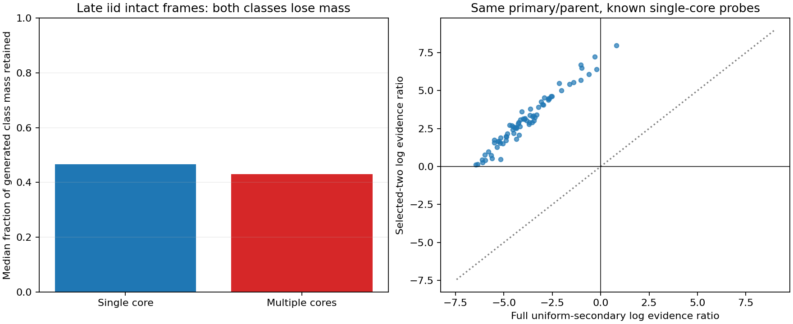

# MG171 - beam-mass and proposal-selection audit

The audit found a large distortion in how MG170 weighted its secondary-core proposals. It chose two promising peaks from the observation and gave them the whole secondary-proposal mass, rather than averaging over the full spatial/width prior. In late independent-noise single-core probes with an accurately located primary, the selected-two calculation favored an extra core in 72/72 comparisons; the exact uniform-secondary calculation favored it in only 1/72. Beam pruning loses substantial mass, but did not create the multiple-core winner in the 288 late intact observations: it slightly reduced that preference on the median one-step comparison. This identifies a concrete inference-method problem, not a failure of the simulated particle. It does not yet repair or qualify the tracker; earlier verdicts and the unresolved status of G remain unchanged.

## Scope and exact reproduction

All 160 MG170 saved sequences and 3840 observations were replayed with an instrumented copy of the frozen step function. The callback only records candidate masses after the generated tree is scored and the retained indices are chosen; it does not change candidate scores, propagation or labels. Every original label/class-weight/beam endpoint matched the published MG170 records. Source/callback/input hashes were frozen and publication confirmed before audit evaluation. The input manifest includes prior seed/truth/comparator and case-denominator records, avoiding the omission disclosed by MG170. No new random fields, Model G trajectories or tracker revision.

## 1. What beam pruning actually did

The audit separates three stages: A sums all generated history weights; B keeps only the maximum history for each distinct endpoint; C additionally retains the original top two endpoints per nonabsent class and one absent endpoint. A proper endpoint merge would sum distinct incoming histories; taking a maximum is an approximation. Separately, top-K removal discards endpoint mass. The two effects are measured rather than assumed to favor a particular class.

| Late independent-noise intact frames | Single-core class | Multiple-core class |
|---|---:|---:|
| Median fraction retained after both losses | 0.466835 | 0.430614 |
| Median normalized weight before losses | 0.000495283 | 0.999488 |
| Median normalized weight after losses | 0.000519449 | 0.99947 |

The median pruning-induced change in multiple/single log odds is -0.0439938, equivalent to an odds multiplier of 0.95696: a slight reduction, not an increase. The multiple class exceeded weight 0.95 in 279/288 frames before pruning and 276/288 after. No class winner changed in those 288 one-step comparisons. Across all 3840 observations, only 4 one-step class winners changed.

These are conditional comparisons given the actual, already-pruned MG170 previous histories. They do not rule out cumulative pruning effects under a fully different history propagation. They do show that simply enlarging the final beam would not remove the late independent-noise multiple preference already present in those generated trees. My earlier explanation of truncation described a possible mechanism; this audit does not support it as the principal immediate cause of that particular failure.

## 2. Secondary proposals received the wrong prior interpretation

For a fixed primary/parent, MG170 selected two secondary candidates using the same current observation being scored. Each then received half of the secondary-proposal prior. This normalization sums to one, but it is a prior over two data-selected peaks, not a uniform prior over possible second cores. The allowed uniform comparison contains 5655 secondary hypotheses: 13 widths times 435 allowed positions outside 2R95. Selecting peaks first and treating their average likelihood as the full model evidence omits the search-volume accounting.

At 640 predeclared probes, the primary was the highest-scoring generated single-core candidate, never chosen by truth. The audit held its parameters, actual parent history, amplitude and innovation covariance fixed, and integrated exactly over every allowed secondary hypothesis. The table restricts known-single scenes to probes whose selected primary was within the predeclared 2-site/0.125-width accuracy bound. Counts for all probes and inaccurate primaries remain in the exports. Some known-single probes are pre-damage observations from control paths.

| Regime | Temporal rho | Accurate-primary single-scene probes | Selected-two ratio favors second core | Full uniform ratio favors second core |
|---|---:|---:|---:|---:|
| 0.1 | 0 | 72 | 1 | 0 |
| 0.1 | 0.95 | 72 | 0 | 0 |
| 1 | 0 | 72 | 72 | 1 |
| 1 | 0.95 | 72 | 33 | 0 |

For late independent noise, the median selected-two log evidence ratio is 2.89508; the median exact uniform ratio is -4.10441. The median paired inflation is 6.951 log units, or a multiplicative factor of about 1044.19. In 71/72 paired probes the selected-two preference for an additional core reverses under full integration.

This is not an instruction to subtract one fixed penalty. Giving the selected two terms weights 1/5655 instead of 1/2 accounts for only the represented part of the uniform prior; omitted hypotheses also have positive likelihood. In these late independent-noise single probes, the two selected terms cover a median 36.9297% of the full secondary evidence. The exact sum is available here; an arbitrary penalty could overcorrect. Under correlated histories the two selected peaks can also miss much of the conditional evidence, because they were proposed from the current field rather than the conditioned residual. The audit preserves both positive and negative distortions.

## 3. Does integration merely suppress every second core?

| True split scenes after onset | Selected-two favors second core | Full uniform favors second core |
|---|---:|---:|
| T=0.1, rho=0 | 12/12 | 12/12 |
| T=0.1, rho=0.95 | 12/12 | 12/12 |
| T=1, rho=0 | 12/12 | 12/12 |
| T=1, rho=0.95 | 6/12 | 6/12 |

The true late independent-noise split examples retain two-core support in 12/12 probes after integration. That is encouraging for a correction, not qualification. Late correlated split probes remain problematic in half the fixed-parent comparisons. An evidence ratio excludes class transition priors and conditions on a data-selected primary and actual parent; it is not the full sequential posterior or a new particle-count classification.

## Checks and retention

Generated prior masses and retained beam weights normalized correctly; no sum-to-one arithmetic defect was found. Independent cache aggregation reproduced all 3840 history/deduplication/pruning decompositions and 640 exact conditional probe integrals. Independent componentwise Fourier sums reproduced 1920 secondary score values. The selected-pair likelihood increments also agreed with the original quadratic differences. Shared endpoint IDs/covariance/templates and same-author checks remain dependencies, not external replication.

The replay/audit took 107.096 seconds on one worker/library-thread1, within 600 active seconds; independent aggregation took 9.90191 seconds. The full local audit cache is 73.388 MB in local_raw/MG171_weight_audit, below 250 MB. Candidate logs, endpoint IDs, retained indices and conditional score grids/residuals are retained there and hash-manifested. Public exports contain compact class-mass/probe summaries and source, not full raw fields or caches. No immutable audit-cache Git commit is claimed.

## Recommended next step

Implement a separately registered model-selection correction that integrates the declared secondary-position/width prior and sums incoming history weights for merged endpoints. Check how beam pruning changes total class mass, and calibrate uncertainty rather than treating normalized survivors as probabilities. Then rerun a full sequential comparison on independent synthetic validation sequences, retaining single/no-core/missing-component/competing-core and correlated-noise tests. This audit does not authorize a new tracker or kinetic run, and it does not rescore MG170 or MG163.
