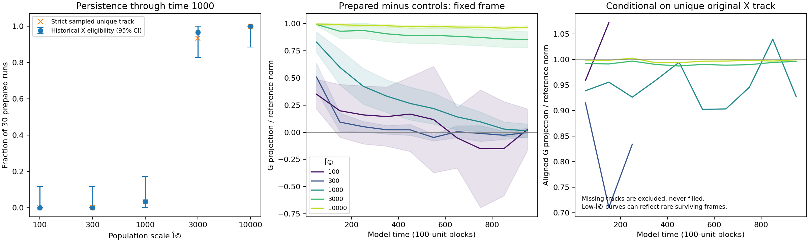

# MG185 Phase 2 G population ladder — results

Increasing the token population made a decisive difference: in this externally supplied, open Phase 2 model, the prepared particle usually disappeared at the lower populations, but its G component remained clearly measurable through time 1000 at the higher populations. At Ω=10,000, all 30 prepared runs retained a unique original X track at every saved observation, and their final-block aligned G signal averaged about 99.9% of the reference amplitude. At Ω=3,000 the result was strong but imperfect: 29/30 passed the historical X criterion and 28/30 passed the stricter sampled-track criterion. This supports population scale as a major reason G was difficult to measure; it does not prove that G persists indefinitely, certify every individual G shape, or transfer the result to the finite-reservoir hypergraph engine.

## Completion and verdict

All 48 numerical-qualification jobs and all 180 planned main trajectories completed, with zero clips. Main includes 150 prepared trajectories and 30 homogeneous Poisson controls. No scientific trajectory was replaced. The interrupted first attempt and its failures remain in the record; continuation reused verified endpoints and original segment seeds. PI closure is pending.

**Population-dependent finite-horizon persistence and G visibility are supported. A universal population threshold and full GXY binary persistence are not established.**

## Persistence counts

| Ω | Historical X persistence | Exact 95% interval | Strict sampled track | Terminal ambiguity |
|---:|---:|---:|---:|---:|
| 100 | 0/30 | [0, 0.115703] | 0/30 | 30/30 |
| 300 | 0/30 | [0, 0.115703] | 0/30 | 30/30 |
| 1000 | 1/30 | [0.000843571, 0.172169] | 1/30 | 29/30 |
| 3000 | 29/30 | [0.827831, 0.999156] | 28/30 | 2/30 |
| 10000 | 30/30 | [0.884297, 1] | 30/30 | 0/30 |

The historical detector tolerates short gaps; strict status requires a unique original track at all 2,001 saved observations. At Ω=3,000, replicate r10 recorded loss at time 99.5. Replicate r22 remained historically eligible but lost a unique track for the last six observations (time 997.5 onward). It is therefore not a strict pass. At Ω=10,000, 30/30 yields a 95% lower reliability bound of about 88.4%, not evidence for 99% reliability. Measurements every 0.5 time unit do not resolve intervening events.

## Direct G result

The following values average time 900–1000 within each run, then average across runs. G is a centered spatial reference projection; 1.0 after normalization means the template-direction amplitude equals the unrounded reference norm. It does not imply exact pointwise shape agreement. Fixed-frame comparisons include all completed prepared runs, even after physical loss. Aligned results use a common X-derived translation and include only unique-original-track observations.

| Ω | Fixed G, prepared | Fixed G, control | Difference, 95% Welch interval | Aligned G / reference | Runs contributing alignment | Valid aligned frames / 6,030 |
|---:|---:|---:|---|---:|---:|---:|
| 100 | 0.0240482 | 0.0137951 | 0.0102531, [-0.0703616, 0.0908678] | missing | 0/30 | 0/6,030 |
| 300 | -0.00150027 | -0.000540705 | -0.000959561, [-0.0180518, 0.0161326] | missing | 0/30 | 0/6,030 |
| 1000 | 0.0106822 | 0.0051237 | 0.00555846, [-0.0210917, 0.0322086] | 0.927117 | 1/30 | 201/6,030 |
| 3000 | 0.363586 | 0.00467683 | 0.358909, [0.32811, 0.389708] | 0.996207 | 29/30 | 5823/6,030 |
| 10000 | 0.405049 | -0.00129291 | 0.406342, [0.399848, 0.412837] | 0.999312 | 30/30 | 6030/6,030 |

The reference G norm is 0.420217. At Ω=1,000, the final aligned mean comes from only one run and cannot represent the full population. At Ω=3,000, 29 runs contribute some late aligned frames, but only 28 retain a unique terminal track. At Ω=10,000 all 30 contribute every final-block frame. These denominators matter as much as the conditional averages. The fixed-frame prepared-minus-control interval excludes zero at the two highest populations; drifting particles can lower fixed-frame projection without destroying their translated shape.

The figure shows exploratory blockwise intervals, without a familywise multiplicity guarantee. Aligned curves are conditional and can remain high while most particles disappear. No new amplitude or residual cutoff was fitted after seeing these results. G/X/Y per-run block projections are retained in decision_exports.json; full relative-amplitude and shape-residual histories remain local.

## Controls and numerical qualification

All six Ω=100 homogeneous controls generated detector-defined birth episodes; none of the six controls at each higher Ω did. This is the legacy detector classification, not independently confirmed creation of physical particles. The low-population background is dynamically noisy; controls are not replacements for prepared trajectories.

| Qualification condition | Fine minus coarse mean G | 95% interval | Allowed margin | Result |
|---|---:|---|---:|---|
| prepared | -0.00114445 | [-0.0118702, 0.00958129] | ±0.0210109 | EQUIVALENT_IN_SCOPE |
| homogeneous | -0.00230502 | [-0.00968863, 0.00507859] | ±0.0210109 | EQUIVALENT_IN_SCOPE |

Qualification used Ω=3,000, time 100, 12 independent runs per condition/resolution and the time-50–100 fixed G average. Both intervals meet the prespecified 5%-of-reference margin. This supports that observable in that scope; it is not an all-population, all-species, time-1000 convergence certificate.

## Verification, resources and deviation

The same-author separate recomputation checked all 18,000 main segments, initial-to-final continuity, registered seeds, nonnegative counts, zero clips, logical/kernel timestamps, and 360,180 snapshots. Direct dot products recomputed G/X/Y fixed projections (maximum difference 4.61853e-14); 277 aligned sentinel frames and all block means/valid-frame counts were checked. Numerical qualification intervals were recomputed from saved measurements. Saved X classifications were cross-checked, but the X detector was shared, not independently reimplemented. This is not external replication.

Charged execution, including qualification and the interrupted attempt, was 49.4112 worker-hours, below the 100-worker-hour cap. Active phase wall times sum to 6.23173 hours, excluding the gap awaiting restart. Full raw occupies approximately 1.2746 GB before the local analysis manifest and stays local. Public outputs contain only compact exports, verification, figure, report and source.

The original storage monitor raced an atomic temporary-ledger rename. The controller stopped as specified after 36 completed jobs. The PI authorized a documented infrastructure fix and continuation: eight intact prefixes resumed and 136 original pending jobs ran. Original ledgers and failure histories remain unchanged. The result joins 36 original completions with 144 continuation completions, exactly once per registered ID. See [continuation amendment](../../spec/MG185_continuation_1.md). No scientific threshold or budget was increased.

## Recommended next step

Use Ω=10,000 as the best-supported working population for the next G-focused validation, with Ω=3,000 retained as a transition comparison. First use these saved histories to quantify per-run G amplitude and shape agreement with explicit uncertainty, without another simulation or treating X success as a G verdict. Then propose a prospective individual-particle G acceptance criterion and, if desired, a longer holdout test. Engine transfer remains separate: match open boundary conditions and finite-step statistics before attributing these results to the existing hypergraph finite-bath implementation. No new simulations are launched by this report.

Inputs: [frozen plan](plan.json), [continuation plan](continuation_plan.json), [compact per-run decisions](decision_exports.json), [verification](verification.json). Historical results and gates are unchanged.
