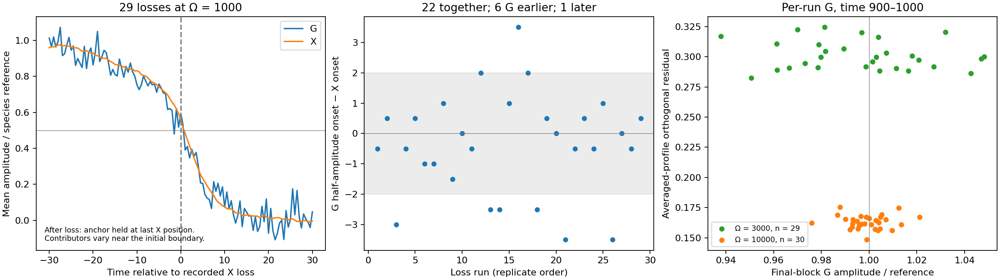

# MG187 bounded G loss audit

G does not emerge as a consistently early weak link in these particle losses. Across the 29 lost Ω=1,000 trajectories, G and X usually faded together: 22 were within two model-time units of each other, six had G fade earlier, and one had G fade later. The median G lead was only 0.5 time units. G remained substantial immediately before the recorded X loss, then both species lost their template-shaped signal. At Ω=3,000 and 10,000, the per-run averaged G amplitude and shape remained similar from the beginning to the end, with appreciably less noise at 10,000. This points toward a coupled particle collapse rather than a general pattern of G disappearing first; temporal ordering alone cannot identify which reaction or fluctuation causes collapse.

## Scope and fixed rule

This was one completed, bounded pass through existing data: 30 prepared Ω=1,000 runs (29 losses plus one survivor), 30 at Ω=3,000 and 30 at Ω=10,000. No new simulations, detector changes, parameter fitting, threshold sweeps or instrument refinement. The choices were committed and published before computing these loss-aligned results, but the MG185 outcomes were already known: this is explicitly post hoc exploratory diagnosis, not a new persistence gate.

Each species amplitude is its centered reference projection divided by its own unrounded reference norm. Fading means a trailing ten-time-unit mean below half amplitude, remaining below for ten units. Timing labels allow ±2 units as together. Both species use the same rule. The first sustained crossing is a diagnostic of template amplitude, not physical extinction.

## What happens in the 29 Ω=1,000 losses

| Comparison | G before | Together | G after | Unresolved |
|---|---:|---:|---:|---:|
| Same half-amplitude rule for G and X | 6 | 22 | 1 | 0 |
| G half-amplitude versus recorded X detector loss | 0 | 2 | 27 | 0 |

For the matched amplitude comparison, G minus X onset has median -0.5, range [-3.5, 3.5] model-time units. The six earlier G crossings lead by only 2.5–3.5 units; the one later crossing lags by 3.5. These small leads are not a universal pre-collapse G disappearance. The surviving run r16 crossed neither sustained half-amplitude threshold through time 1,000 and is retained as censored, not one of the 29 losses.

The two rows compare different clocks. The X loss timestamp is the last matched detection, confirmed retrospectively after twenty unmatched units. The amplitude rule uses a trailing mean, which delays its reported crossing. Thus the 27 “after detector loss” cases do not establish that G outlives X physically. The matched G-versus-X amplitude row is the fairer ordering comparison.

| Window relative to X detector loss | Mean G amplitude | Mean X amplitude | Mean instantaneous G residual |
|---|---:|---:|---:|
| −20 to −10 | 0.868756 | 0.876827 | 6.62088 |
| −10 to 0 | 0.696315 | 0.735826 | 6.61963 |
| 0 to +10 | 0.273024 | 0.274529 | 6.62353 |
| +10 to +20 | 0.0361551 | 0.0362787 | 6.63388 |

All 29 runs had average G amplitude above 0.5 in the ten units before X loss; their values ranged from 0.551743 to 0.855284. Both species declined across the loss transition. The full per-run timing table is [Omega1000_loss_timing.csv](Omega1000_loss_timing.csv). No timing threshold was adjusted after these results.

Until loss, alignment follows only the existing unique-original X track. Missing positions carry the last known position; after loss that anchor is frozen. Post-loss values therefore measure G/X overlap at the last known location. A moving remnant could evade that measurement, and this audit deliberately did not add a new tracker to resolve it.

## Per-run G amplitude and shape at higher populations

Amplitude is normalized to the reference. Shape residual is the norm of the component orthogonal to that reference, also divided by the reference norm; zero would mean a perfect scaled shape. “Averaged profile” first averages aligned fields within each run and block, then measures residual. It suppresses temporal noise. “Instantaneous residual” averages the residual of each separate snapshot and therefore retains noise. Neither is an individual particle pass/fail threshold.

| Ω | Block | Contributing runs | G amplitude median [range] | Averaged-profile residual median [range] | Instantaneous residual median |
|---:|---|---:|---|---|---:|
| 3000 | initial | 30/30 | 0.995918 [0.924704, 1.02635] | 0.299949 [0.277813, 0.314593] | 3.80593 |
| 3000 | final | 29/30 | 0.998656 [0.937946, 1.04817] | 0.299668 [0.282559, 0.324507] | 3.82221 |
| 10000 | initial | 30/30 | 0.999487 [0.974758, 1.01452] | 0.163314 [0.155149, 0.177304] | 2.08263 |
| 10000 | final | 30/30 | 0.998932 [0.975884, 1.02114] | 0.162413 [0.148309, 0.17553] | 2.09474 |

Blocks are time 0–100 (excluding 100) and 900–1000 (including 1000). At Ω=3,000, r10 has no unique final-block track and is explicitly missing; r22 contributes 195/201 final-block frames but loses terminal uniqueness. Final totals are 5,823/6,030 valid frames at 3,000 and all 6,030 at 10,000. Full per-run amplitude, amplitude variability, both residuals and missing counts: [Ω=3,000 table](Omega3000_per_run_G.csv), [Ω=10,000 table](Omega10000_per_run_G.csv).

The averaged-profile residual is stable between initial and final blocks: about 0.300 at Ω=3,000 and 0.163 at 10,000. This gives no sign of widespread progressive G shape erosion among the trackable profiles. Instantaneous residuals remain much larger than the reference shape norm—about 3.82 and 2.09 in the final blocks. G is therefore still noisy in individual full-domain snapshots; near-unit mean amplitude must not be read as a noise-free instantaneous shape. No noise subtraction or residual recalibration was introduced.

## Checks and conclusion

All 9,000 input segments matched the previous local hash manifest. Raw-field projections matched saved valid-frame amplitudes to within 5.11e-15. The orthogonal-energy identity and all higher-population block means passed. Synthetic before/together/after/censored cases passed, and a separate arithmetic path recounted timing labels from continuous offsets. Shared reference, X track/loss events and FFT implementation remain dependencies; this is same-author checking, not external replication. The raw-data pass took about 22.4 seconds on one worker. Scientific histories remain unchanged and local.

**Answer:** G is noisy, but this audit does not show it systematically fading well ahead of X. The dominant observed behavior is G and X losing their coherent pattern together. The six small G leads are real under this fixed diagnostic but are insufficient to identify G as the causal weak link. Higher population preserves a stable averaged G component in the trackable particles, with Ω=10,000 clearly cleaner than 3,000.

The requested bounded audit ends here. No further instrument development or simulations are launched. MG185 persistence verdicts remain unchanged; PI closure remains pending. Inputs and exact choices: [MG187 specification](../../spec/MG187_bounded_G_loss_audit.md), [machine-readable audit](audit.json), [verification](verification.json), [arithmetic check](arithmetic_check.json).
