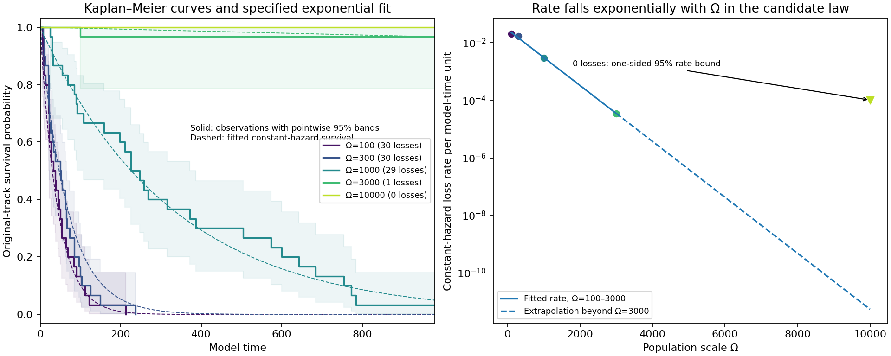

# MG188 lifetime law from saved trajectories

The saved trajectories support a much stronger statement than a survival count: a prespecified censored-lifetime fit estimates that mean original-track lifetime grows by about 9.4 times for every additional 1,000 in population scale Ω. Its model-conditional 95% interval is about 6.2–14.9 times. The exponential-in-Ω candidate passed the fixed diagnostic screens and substantially outperformed the prespecified power law; allowing a time-dependent Weibull hazard gave no decisive improvement. This is a useful empirical lifetime law for these prepared Phase 2 patterns, not a universal physical law or a measured lifetime at Ω=10,000. At that population no loss was observed, so its mean remains unmeasured.

## Quotable statement

> For the prepared Phase 2 Model G patterns studied here, a censored exponential-lifetime fit estimates a roughly 9.4-fold increase in mean original-track lifetime per additional 1,000 in Ω (model-conditional 95% interval: 6.2–14.9-fold).

“Original track” matters: this endpoint follows the original X-defined pattern until its recorded disappearance, even if replication occurred. It is neither a G-only shape-persistence test nor a guarantee that a single isolated particle remains intact. MG187 found that G and X usually fade together, which supports interpreting this as a coupled-pattern lifetime, but does not redefine the endpoint.

## Fixed analysis and censoring

All 150 prepared runs were included, 30 per population; controls have no prepared original track and were excluded. Fit choices and diagnostic rules were committed and published before computation, in [the specification](../../spec/MG188_lifetime_analysis.md). Prior survival counts were already known, so this remains an explicitly post hoc analysis. No new simulations or random resampling occurred.

The detector timestamps loss at the last matched observation and needs twenty later unmatched units to confirm it. Every run was therefore administratively censored at time 980, leaving the same confirmation window. Loss events at or before 980 count as events; other runs are right-censored. This avoids silently treating unconfirmable terminal disappearances as survived lifetimes. Observation spacing is 0.5 model-time units; there is no calibrated conversion to seconds.

## Empirical survival results

| Ω | Losses / 30 | Right-censored | KM median lifetime | Restricted mean through 980 | Losses / exposure rate |
|---:|---:|---:|---|---:|---:|
| 100 | 30/30 | 0 | 37.5 | 48.2167 | 0.0207397 |
| 300 | 30/30 | 0 | 51.5 | 58.5667 | 0.0170746 |
| 1000 | 29/30 | 1 | 247 | 325.5 | 0.00296979 |
| 3000 | 1/30 | 29 | not reached | 950.65 | 3.50637e-05 |
| 10000 | 0/30 | 30 | not reached | 980 | 0 |

Restricted mean is the average time alive within the 980-unit observation window; it does not extrapolate beyond it. For Ω=100 and 300 all losses were observed, so it equals their sample mean lifetime. At Ω=3,000 and 10,000 the median is not reached; quoting 980 as their unrestricted mean would be wrong.

The survival bands are pointwise Greenwood log-log intervals. Boundary bands at survival 1 with no events are degenerate and should not be read as certainty of perfect reliability; use the event-count intervals and censoring limits. The plotted zero-event rate bound is one-sided and assumes a constant time hazard.

## Fitted law

The primary model is λ(Ω) = exp(-5.78715 − 2.23802 × (Ω−1000)/1000), with S(t|Ω)=exp(−λt). Equivalently:

**Mean lifetime μ(Ω) ≈ 326.083 × exp(2.23802 × (Ω−1000)/1000) model-time units.**

Each +1000 in Ω multiplies this fitted mean by 9.37471, with a 95% profile-likelihood interval [6.22612, 14.9283]. This interval is conditional on independent trajectories and the chosen constant-hazard, log-linear-in-Ω model. It does not include model-selection uncertainty or prove extrapolation.

| Prespecified candidate | Parameters | Log likelihood | AICc |
|---|---:|---:|---:|
| exponential_in_Omega | 2 | -507.895 | 1019.87 |
| power_in_Omega | 2 | -532.584 | 1069.25 |
| Weibull_in_Omega | 3 | -506.488 | 1019.14 |

The power-law candidate is worse by 49.3771 AICc units. Weibull improves AICc by only 0.731222, below the prespecified six-unit concern threshold. Its common shape is 1.14757, with approximate 95% Wald interval [0.982351, 1.34057], which includes the constant-hazard value 1. Every primary-model predicted event fraction lies inside its population's observed exact binomial interval. These are compatibility screens, not proof of the law or calibrated global goodness-of-fit tests.

| Ω | Observed losses | Predicted losses by 980, primary fit |
|---:|---:|---:|
| 100 | 30 | 30 |
| 300 | 30 | 30 |
| 1000 | 29 | 28.5144 |
| 3000 | 1 | 1.00855 |
| 10000 | 0 | 1.61212e-07 |

## What the high-population censoring can and cannot tell us

At Ω=3,000, one observed loss gives a separate constant-hazard mean estimate of 28519.5; that extrapolated mean is very uncertain because it rests on just one event. At Ω=10,000 there is no finite separate maximum-likelihood estimate of mean lifetime. Under the constant-hazard assumption, its 30 censored runs provide only a one-sided 95% lower bound of 9813.96 model-time units.

The population law extrapolates an Ω=10,000 mean of 1.82369e+11 units—vastly beyond the 980-unit follow-up. **That number is a mathematical extrapolation, not an observed or validated lifetime, and should not be quoted as a persistence result.** The slope is principally informed by losses at Ω=100, 300, 1000 and the single loss at 3000. Zero losses at10000 are compatible with the trend but do not measure its continuation across the large population gap.

## Original disappearance versus solitary-particle lifetime

The prespecified secondary endpoint ends at the first loss, replication or merge. It gives an exponential-in-Ω factor of 16.6382 per +1000, materially larger than the primary 9.37471. All30 Ω=100 runs had replication or merge events, compared with one at300 and none at1000 or above. Early replication shortens solitary-particle persistence even when the original track continues. The quotable primary statement must therefore retain its original-track endpoint; these two lifetime definitions cannot be interchanged.

## Verification and conclusion

Event times were independently re-extracted from the immutable per-run summaries and matched to the MG185 exports. Every Kaplan–Meier restricted mean matched the direct mean of capped observation times. The analytic exponential profile likelihood matched a general numerical optimizer; a separate arithmetic path reconstructed its likelihood from population event/exposure totals and checked the zero-event lower bound. Censoring fixtures passed. Same author and shared legacy X detector/NumPy/SciPy remain dependencies; this is not independent external replication. Full precision, individual observation times, curves and all candidate fits are retained in [fits.json](fits.json), [observations.csv](observations.csv), [verification](verification.json) and [arithmetic check](separate_arithmetic_check.json).

**Conclusion:** “roughly ten times longer mean original-track lifetime per +1,000 Ω” is supported as a fitted empirical summary of this dataset, with the stated model dependence and uncertainty. It is stronger than raw survival counts because it uses when losses occurred and accounts for right-censoring. It remains a finite-data, endpoint-specific law for this implementation, not proof of indefinite persistence. No new simulations, further model search or historical rescoring follows this report. PI closure is pending.
