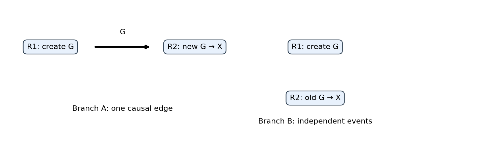
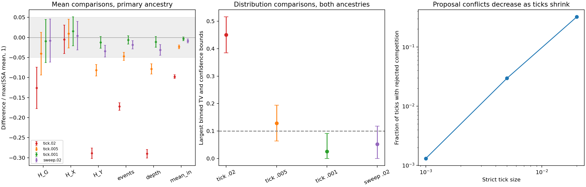

# MG189 small-system causal-invariance study

The small-system study found that independent Model G events commute, but the same final species counts do not determine a unique causal history. A two-event example already shows the distinction: create a G and then convert either that newly created G or an older G into X; the final counts match, while one history has a causal edge and the other does not. Scheduler statistics move toward continuous-time behavior as strict ticks shrink, but the finest tested tick remains statistically inconclusive under the fixed all-summary rule. This establishes conflict-free commutation in the tested cases and failure of count-level finite-history uniqueness; it does not establish or refute full Wolfram-style causal invariance, Lorentz invariance, quantum behavior, or particle-scale scheduler independence.

## Study and interpretation

The PI requested the reviewer outline [causal_invariance_study_plan.md](../../spec/causal_invariance_study_plan.md), with D1–D4 adopted. Detailed fixtures, semantics, margins, seeds and predictions were published in commit dedce91 before evaluation: [MG189 registration](../../spec/MG189_causal_invariance.md), [seed/source manifest](plan.json). Existing engines and reviewer text were not modified. One worker evaluated toy systems, not particles. Full traces remain local.

| Question | Finding | Scope |
|---|---|---|
| T1 overlapping matches | All 25 pairs rejoin by counts within two extra events; none by identical IDs in that bound | Initial matches in F2/F3 only; no “never rejoins” proof |
| T2 independent reorderings | All 1,192 pairs pass, both ancestry conventions | Every initial disjoint two-event pair in F1/F4 |
| T3 same-state causal histories | Count-level criterion fails in all three fixtures; tested identity-rich pairs match | Bounded prefixes, counts versus canonical token identities |
| T4 strict-tick time slicing | Accepted sets pass reverse replay; rejected proposal conflicts decline sharply | 1,024,000 sampled strict ticks |
| T5 scheduler statistics | Coarse/medium ticks differ; finest tick and random sweep remain inconclusive overall | 8,192 paths/method, 0.1 time units, 4 sites/12 initial tokens |

**Registered three-level outcome:** conflict-free commutation is supported within the tested cases. Exact count-level finite-history graph uniqueness fails. A scheduler-independent statistical qualification has not been obtained; this is distinct from evidence that no continuum limit exists.

## Exact tests and a minimal witness

Start with one site containing G=1, X=2, Y=1. Both branches apply R1 then R2 and finish at G=1, X=3, Y=1, Z=W=0. In branch A, R2 consumes the newly supplied G and therefore depends on R1. In branch B, R2 consumes the initial G; the events are independent. A labeled DAG with one edge is not isomorphic to two isolated nodes. These are equal-length branches, so the result is not an artifact of comparing different numbers of events. It does not involve R4, and omitting catalyst edges cannot remove it.

Counts erase token ancestry. The witness disproves uniqueness under the registered count-reconvergent, finite-prefix graph criterion. It does **not**, by itself, prove that the full microscopic rewriting system lacks a common causal completion under all future updates. That stronger Wolfram-style question is not settled by this bounded test.

| Fixture | Depth | History prefixes | Count-reconvergent equal-depth pairs | Matching labeled graphs | Match fraction | Identity-reconvergent pairs / matching |
|---|---:|---:|---:|---:|---:|---|
| F2 | 3 | 555 | 4440 | 1687 | 0.379955 | 657 / 657 |
| F3 | 2 | 172 | 268 | 180 | 0.671642 | 65 / 65 |
| F4 | 2 | 2613 | 6496 | 3574 | 0.550185 | 1179 / 1179 |

F2 is one site with four tokens; F3 is two sites with four; F4 is the four-site ring with twelve. Every prefix through the stated depth was enumerated, with no cap reached. Fractions count enumerated history pairs, not stochastic probabilities. All-depth and equal-depth denominators, state counts and both ancestry variants are in [exact_results.json](exact_results.json).

Identity-rich agreement is much more restrictive: fresh token names encode the input identities that produced them. Many count reconvergences therefore cease to be identity reconvergences. Matching tested identity-rich pairs cannot be promoted to an independent proof of microscopic causal invariance; naming retains ancestry by design. Catalyst read-only sensitivity also fails the count-level criterion in F2/F3/F4. It is an ancestry-only counterfactual on the same event histories, retaining the primary reservation and identity grouping, rather than a separately validated read-only rewrite dynamics.

All 25 overlapping initial match pairs rejoined within the two-event count search. Consequently the reviewer prediction that some resource conflicts never reconverge was not established by this test. The 25 bounded identity nonjoins are not evidence of impossibility at unlimited depth. Catalogue and input-level witnesses: [conflict_catalogue.json](conflict_catalogue.json), [counterexamples.json](counterexamples.json).

## Tick slicing and proposal competition

Accepted strict-tick events reserve disjoint pre-tick participants. New outputs cannot act until the next tick. Every sampled accepted set was replayed in reverse order; final identities, primary producers and labeled causal edges matched under an explicit event mapping. There are no conflicts among accepted events. The following rates concern overlapping proposals rejected by reservation.

| Tick | Ticks checked | Ticks with rejected competition | Fraction | Rejected proposals per model-time unit |
|---:|---:|---:|---:|---:|
| 0.02 | 40960 | 13205 | 0.322388 | 19.4275 |
| 0.005 | 163840 | 4839 | 0.0295349 | 6.01929 |
| 0.001 | 819200 | 1072 | 0.00130859 | 1.31226 |

The per-time rejection rate also falls, so the effect is not solely the larger number of smaller ticks in the denominator. Reverse replay establishes bookkeeping consistency of accepted independent events, not equivalence of strict and continuous-time probability laws.

## Statistical scheduler comparison

Continuous-time rate-weighted SSA is the reference. Strict ticks are 0.02, 0.005 and 0.001. The random sequential comparator shuffles all channels each 0.02 window and applies each single-channel process in place; outputs can participate in later channels. It is a rate-preserving split approximation, not rate-blind rule choice and not every possible random sequential algorithm.

For each path, summaries include nine rule/transport counts, event count, causal depth, maximum layer occupancy, and mean/max in/out degree. “Layer width” is the largest depth layer, not the exact maximum antichain. Two ancestry conventions give 32 comparisons per scheduler. Mean margins are 5% of max(SSA mean, 1); rare counts therefore have an absolute 0.05 margin. Distribution margins are 0.10 total variation after fixed binning. Bonferroni Welch mean intervals and multinomial TV bounds each form their own nominal 95% family, not one combined 95% claim. Coarsened distribution agreement cannot certify the full distribution or graph law.

| Method | Mean: equivalent / inconclusive / different | Binned distribution: equivalent / inconclusive / different | Overall |
|---|---|---|---|
| tick.02 | 17 / 3 / 12 | 16 / 8 / 8 | DIFFERENT_IN_SOME_SUMMARIES |
| tick.005 | 24 / 4 / 4 | 22 / 10 / 0 | DIFFERENT_IN_SOME_SUMMARIES |
| tick.001 | 28 / 4 / 0 | 32 / 0 / 0 | INCONCLUSIVE |
| sweep.02 | 28 / 4 / 0 | 24 / 8 / 0 | INCONCLUSIVE |

The finest tick qualifies all 32 binned-distribution comparisons and 28/32 means. Its four inconclusive means are G- and X-hop counts, repeated under both ancestry conventions. In the primary convention, the G-hop difference is −0.0102539 with interval [−0.0703557, 0.0498479], versus margin ±0.0561401; the X-hop difference is 0.0152588 with interval [−0.0207698, 0.0512874], versus ±0.05. These intervals overlap equivalence and nonequivalence regions: they are precision limitations, not demonstrated nonzero bias. No samples were added or margin relaxed to obtain a pass.

At the coarsest tick, mean Y hops decrease from 16.8916 under SSA to 12.0109, and causal depth from 5.10266 to 3.62207 (primary ancestry). At tick0.005 those means are 15.5116 and 4.70081. Refinement moves these major discrepancies toward SSA; finite coarse-tick scheduling is demonstrably consequential. Random sweep shows no declared differences but also fails full equivalence on the fixed precision criteria. Detailed per-summary intervals, margins and TV bounds: [statistical_results.json](statistical_results.json).

## Verification, resources and implications

Sampling and exhaustive evaluation took 188.852 seconds on one worker; the final saved-trace audit took 21.6399 seconds. Full raw occupies 28.0343 MB locally. The evaluator checked initial identity-summed hazards and drift against the existing open-boundary bridge generator (including the catalytic pair factor); deterministic graph witnesses were cross-checked with NetworkX isomorphism. The separate audit rederived species roles, site transitions, token validity and causal edges for all 40,960 paths and 1,198,767 events, recomputed graph summaries using adjacency matrices, and checked all128 comparison rows via separate interval/histogram calculations. All passed. Initial registration was interrupted before the seed plan existed, then safely completed; no scientific draws preceded publication. Sources/criteria were unchanged after evaluation began.

This is same-author verification with shared fixtures, NumPy/SciPy and reference semantics, not external replication. The new small-system interpreter matches the specified open active generator, but this is not a new full qualification of the existing finite-bath particle engine. Finite-depth graphs and coarse statistical summaries leave many microscopic and long-time properties untested.

**Practical conclusion:** retain the update scheduler and tick size as explicit model assumptions. The evidence supports commuting independent events and convergence toward SSA for several causal summaries as ticks shrink, while count-level causal-history uniqueness fails. Full statistical scheduler invariance remains unqualified at the prespecified precision. Neither a Lorentz-invariance claim nor a quantum/gravity connection follows from these results.

The registered small study ends here. No rule redesign, sample extension, particle run or large-system bridge is launched. PI closure is pending. [Implementation specification](../../spec/MG189_causal_invariance.md), [verification](verification.json), [complete run record](attempt.json).
