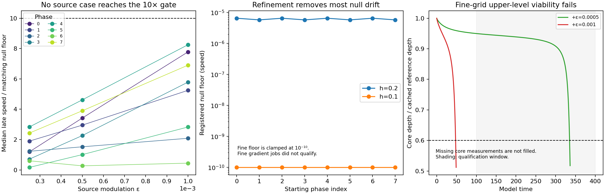

# MG191 periodic G-gradient study — results

This study is unresolved: it does not provide a clean numerical test confirming or contradicting the proposed SQK gravity response. The coarse lattice shows visible drift, mostly toward lower G, but none of the source-gradient cases exceeds the agreed ten-times-null-drift threshold. The finer lattice has negligible null drift, yet its upper-source uniform checks fail particle viability, so the planned fine-grid gradient runs cannot supply the required mesh comparison. The controls therefore exposed two distinct limitations—coarse-grid pinning and fine-grid soliton viability—before an apparent downhill signal could be mistaken for a qualified gravity result. All admitted runs completed without execution errors, and the frozen result is UNRESOLVED.

## Completion and registered verdict

**UNRESOLVED.** P1* direction/resolution gate not supported; P4* mesh-refinement gate not supported. This is neither SUPPORTED nor CONTRADICTED. “NO RESOLVED RESPONSE” is not assigned because the fine-gradient arm is missing, not demonstrated silent on a viable mesh.

The PI approved the revised gate, offset phases, epsilon ladder and two-worker-hour budget. Source, full job grid and background hashes were frozen in af28841 before evaluation. All 31 qualification jobs completed;14/16 uniform viability cases and all 15 background stability checks passed. Two fine viability cases failed the scientific criteria. This prospectively excluded16 H jobs; all 104 admitted production trajectories then completed to T = 2000. There were no retries, replacements, cap stops or source/criteria changes.

Inputs and criteria: [approved design](../../spec/MG191_gravity_gradient_draft.md), [implementation contract](../../spec/MG191_implementation_contract.md), [frozen plan](plan.json), [qualification summary](qualification_summary.json). The source-sign convention remains as verified in [MG190 D3](../../spec/MG190_D3_source_check.md); these numerical limitations do not change that reading of LaViolette.

## Qualification: the fine gradient grid could not proceed

| Failed case | Uniform source a | Finding | Consequence |
|---|---:|---|---|
| h=0.1, +ε=0.0005 | 14.007 | Minimum recorded depth ratio 0.517385; original-core qualification lost by time 337 | Excludes8 H cases at ε=0.0005 |
| h=0.1, +ε=0.001 | 14.014 | Original core untrackable by 49.5; no valid frames in 100–400 | Excludes8 H cases at ε=0.001 |

Their homogeneous backgrounds remain linearly stable. The failed criteria concern the localized particle and its original-track/shape viability, not a linear instability of the particle-free ether or a numerical solver crash. All coarse uniform extremes passed; all three coarse epsilons remained admitted. The study did not substitute smaller refinement epsilons or change the operating point after seeing these exclusions.

## Direction and mobility on the coarse lattice

Both source and reverse arms retain valid cores in every after time 500 observation. Mobility is fitted to the actual equilibrated background −dG/dx, not to the source formula. Positive mobility means motion toward lower G. Values below are raw descriptive fits; none is a qualified resolved response. Ranges are across eight deterministic phases, not stochastic confidence intervals.

| ε | Raw downhill / uphill A cases | Median raw mobility [range] | Median absolute speed | Largest speed/null-floor ratio | Resolved cases |
|---:|---|---|---:|---:|---:|
| 0.00025 | 7 / 1 | 0.0510235 [-0.0820746, 0.166929] | 7.85582e-06 | 2.83146 | 0/8 |
| 0.0005 | 7 / 1 | 0.051381 [-0.0183271, 0.103425] | 1.50034e-05 | 4.61645 | 0/8 |
| 0.001 | 8 / 0 | 0.0499298 [0.0153438, 0.0706698] | 3.17516e-05 | 8.25107 | 0/8 |

Coarse-grid null floors range from 5.75694e-06 to 6.50011e-06 model-lengths per model-time unit. Resolution requires the matching case to exceed ten times its own floor. The strongest source case reaches only 8.25107 times its floor. Atε=0.001 all eight raw signs are downhill, but that does not override the frozen resolution criterion. The two uphill raw signs at weaker gradients are also unresolved, so they do not meet the criterion for contradiction.

Every reverse pair passes the specified mirror envelope; the largest summed opposite velocity is 5.55632e-11. Reflection is a useful implementation check, but lattice pinning also reverses under reflection, so mirror agreement alone is not evidence that the drift is gravitational.

P2 linear response is not qualified: no source case is resolved under the fixed rule. A log-log slope was therefore not fitted using the below-floor data. Raw phase-specific mobilities and 50-unit velocity/gradient pairs remain available in [decision_exports.json](decision_exports.json) and [per_run_results.csv](per_run_results.csv). No post hoc null subtraction was used to manufacture a resolved result.

## Controls, specificity and arrival

The fine null trajectories all remain valid and have speeds near floating-point precision; their registered floors clamp at 1e-10. That improvement does not complete P4 because no fine gradient trajectory passed admission. Uniform lower-source controls (a=13.986, no gradient) exceed their matching coarse null floor in median speed in 8/16 level cases; the maximum-block diagnostic flags 8/16. Thus changing the background level itself alters the coarse drift, independently reinforcing the pinning/bias concern.

All 24 criticality-gradient runs are likewise below the ten-times-null threshold. Their raw phase-paired median-speed ratios C/A are descriptive only:

| ε | Median phase-paired speed ratio C/A | Phase range |
|---:|---:|---|
| 0.00025 | 0.994529 | [0.100323, 7.0709] |
| 0.0005 | 0.573135 | [0.0525842, 3.89039] |
| 0.001 | 0.367292 | [0.0540654, 2.5964] |

These ratios include small unresolved denominators and cannot certify G-specificity. The criticality background has a small, recorded G leakage (MG190 found about 0.0632% of A at matching ε); it is not exactly flat in G. Arm A also changes X with G, so even a resolved comparison would have limited specificity. P3 remains unqualified.

None of the 24 A or 24 R trajectories enters the prescribed near-minimum region by T = 2000. All arrival times are censored. This is descriptive and is not a failed arrival gate: the approved design deliberately separated slow/nonarrival from a negative direction result.

## Independent saved-data verification and resources

A separate same-author implementation remeasured every saved X core using tiled peak detection and sign-change interpolation, checked all 4,288 local field checkpoints and 428,920 unique observations from 120 trajectories (104 production + 16 viability), reconstructed permanent identity/shape flags, recomputed velocities and fitted mobility with least squares. Maximum core-measurement discrepancy was 2.84217e-14. Source/input hashes, positive finite G/X/Y fields and exact endpoint continuity passed. The registered nonuniform eigenvalue computations were not independently re-solved during this audit. Shared reference, thresholds and NumPy/SciPy remain dependencies; this is not external replication.

Controller execution took 2.99456 minutes of wall time. Charged execution including the conservative pre-run allowance was 23.3676 worker-minutes; the main saved-field audit added 88.718 seconds. This is comfortably within the approved 120 worker-minute budget. Full raw occupies 3.05008 GB under local_raw/MG191_gravity_gradient and remains local. Public content is limited to source, manifests, compact measurements, figures and this report.

**Interpretation:** the study has found an operating-window and lattice limitation, not established a gravity law. A future clean test would need a particle-supporting regime shared by both meshes while preserving the same source/criticality controls. That would require a separately specified study; changing parameters or relaxing thresholds here would erase the value of the registered result. No further run, instrument revision or parameter change is launched. PI closure is pending.

Records: [completion](attempt.json), [verification](verification.json), [gate reduction check](gate_reduction_check.json), [full compact decisions](decision_exports.json).
