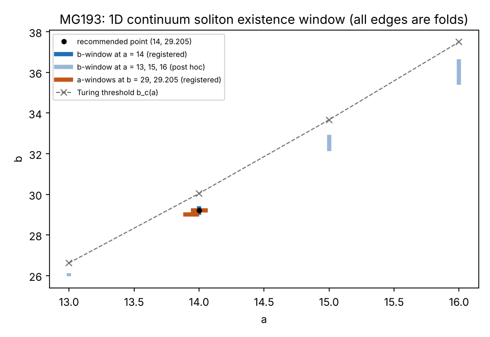

# MG193 results: continuum 1D existence and stability window of the Model G soliton in (a, b)

**Summary.**
- **At a = 14, the 1D continuum soliton exists and is linearly stable for 28.9952 ≤ b ≤ 29.4153.** Both ends are
  saddle-node folds.
- **Recommended 1D operating point: a = 14, b = 29.2053**, the window centre.
  - Its margin to each b edge is 0.2101, about 0.72% of b.
  - In a, it can move from −0.44% to +0.49% before reaching a fold. At the published b = 29 that range is only +0.011%
    on the high side.
  - A 1%-perturbed run at this point relaxed back to the stationary soliton.
- **The window is a narrow diagonal strip in (a, b), not a box.**
  - It sits just below the Turing threshold and moves up with it as a increases.
  - The registered b-lines at a = 12, 13, 15, 16 could not be reached by the registered route, which moves a at fixed
    b = 29.2053. Those lines are unmapped as registered.
  - A labelled post-hoc follow-up along the strip shows the window widening with a: width 0.15 at a = 13, 0.42 at
    a = 14, 0.79 at a = 15 and 1.25 at a = 16. The strip was lost near a = 12.95.
- **Comparison with lattice windows.** The edges agree with the earlier lattice windows and converge toward them as the
  mesh is refined: lower edge 28.929 → 28.978 → 28.995 and upper edge 29.397 → 29.412 → 29.415, going from h = 0.2 to
  h = 0.1 to the continuum.

For the programme, this means the published point b = 29 is a poor place to test 1D particle dynamics. It sits 0.005
above the lower fold in b and 0.011% below the fold in a. That explains MG192's dissolving off-centre particles, and
plausibly some of the fragility seen in earlier 1D lattice studies. A point such as (14, 29.205) has margins about 40
times larger in b, and is the natural place to redo MG192's dynamic check. Larger a would give a wider window still.
All of this is 1D continuum only: 2D and 3D windows are known to sit much lower (MG003), and nothing here involves
noise or the token engines.

Registered specification: `spec/MG193_existence_window.md`, frozen and committed at `7586da8` before any calculation.
PI approval: Richard Benear, 2026-11-16 06:14 America/Denver ("Go ahead with the existence-window mapping."). Design,
implementation, run and report: Claude, at the PI's request. MG193 is a descriptive mapping study with numerical
qualification checks and no hypothesis gates.

## Registered results

### a = 14 line in b

| Edge | b | Type | Approach |
| --- | ---: | --- | --- |
| Lower | 28.99517 | FOLD | Least-stable even eigenvalue → −0.0009; odd stays at −0.197. Core depth −8.12 at the edge. |
| Upper | 29.41534 | FOLD | Both even (−0.0009) and odd (−0.0015) eigenvalues → 0 together. Core depth −10.17. |

- Window width 0.42017; centre b* = 29.20526.
- The homogeneous Turing threshold b_c(14) = 30.04408 was not reached. The upper fold lies 0.629 below it.
- No stability loss before either fold: every converged point was linearly stable.

### a-lines

| b | a_low (edge) | a_high (edge) | Width relative to 14 |
| ---: | ---: | ---: | ---: |
| 29 | 13.87748 (FOLD) | 14.00160 (FOLD) | −0.875% / +0.011% |
| 29.20526 (b*) | 13.93819 (FOLD) | 14.06803 (FOLD) | −0.442% / +0.486% |

### b-lines at a = 12, 13, 15, 16: not mapped as registered

The registered route (§2: start from the a = 14 solution and continue in a at b = b*) fails at a = 13.92 going down
(positivity) and at a = 14.08 going up (no convergence), because the a-window at b* is only [13.938, 14.068]. These four
lines are therefore **unmapped under the registration**. This is a design flaw: I assumed the window would be broad in a.
The post-hoc strip map below fills the gap descriptively.

### Recommended operating point

- a = 14, b = 29.20526. Margins: 0.21009 to both b edges; −0.442% / +0.486% in a.
- Least-stable eigenvalues there: even −0.154, odd −0.156 (translation mode removed). At b = 29 the even value is
  −0.042.
- Perturbed ETDRK4 run (1% random even and odd perturbation, seed 20261116, T = 200): core depth −9.59473 → −9.59467,
  a change of 6e-6 relative, within the 1% criterion. **PASS** under the registered wording; see deviation D3.

### Numerical qualification (§4)

| Grid | b_low | b_high | Difference from L = 100, N = 1024 |
| --- | ---: | ---: | ---: |
| L = 100, N = 1024 | 28.99517 | 29.41534 | — |
| L = 100, N = 2048 | 28.99517 | 29.41535 | 1.7e-6 / 6.0e-6 |
| L = 200, N = 2048 | 28.99517 | 29.41535 | 1.7e-6 / 6.0e-6 |

Both pass the 1e-3 requirement by more than two orders of magnitude. The L = 200 brackets are identical to the
L = 100, N = 2048 ones at the 1e-5 bracketing resolution, because the soliton's tails are negligible beyond |x| = 50.
All edges are qualified.

### Separate check: time-dependent runs near each edge (§6)

Each run starts from the nearest converged stationary profile and runs to T = 500 (ETDRK4, dt = 0.002).

| Edge | Inside run | Outside run |
| --- | --- | --- |
| a = 14, lower b (28.995) | depth −8.4625 unchanged to 5 digits: **PERSISTS** | dissolves by T ≈ 150: **DISSOLVED** |
| a = 14, upper b (29.415) | depth −10.136 unchanged: **PERSISTS** | side minima multiply, 3 → 9 below −1: **CHANGED** (replicating) |
| b = 29, upper a (14.0016) | depth −8.6137 unchanged: **PERSISTS** | dissolves by T ≈ 150: **DISSOLVED** |
| b = 29, lower a (13.8775) | depth −9.9196 unchanged: **PERSISTS** | side minima multiply, 3 → 13: **CHANGED** (replicating) |

**All four edges are confirmed.** They also fall into two kinds:
- On the low-b and high-a sides (further from the Turing threshold), the particle **dissolves**.
- On the high-b and low-a sides (closer to the threshold), it **replicates**.

The verdicts in this table follow the registered wording. The driver's own labels differed for the inside runs; see D3.

## Comparison with Phase 2 estimates (context only; definitions differ)

| Source | Lower edge | Upper edge |
| --- | ---: | ---: |
| Lattice h = 0.2 (MG003) | 28.929 | 29.397 |
| Lattice h = 0.1 (MG003) | 28.978 | 29.412 |
| Continuum operational b_s (MG003) | 28.993 | — |
| **Continuum, this study** | **28.9952** | **29.4153** |

The lattice windows converge toward the continuum one as h shrinks. MG9's creep-to-invade switch near b ≈ 29.40 on the
h = 0.2 lattice sits at that lattice's upper edge, consistent with the replicating upper edge found here.

## Post-hoc analyses (not registered tests)

`src/mg193_posthoc.py` was written after the registered run was seen; its output is in `posthoc.json`.

**1. Following the strip.** The strip slope from the two registered a-windows is db/da ≈ 3.23. Stepping along
b = b* + 3.23 (a − 14) and then mapping b at fixed a, with the same continuation code, gives:

| a | b window | Width | Edges | b_c(a) | Gap from upper edge to b_c |
| ---: | --- | ---: | --- | ---: | ---: |
| 13 | [25.966, 26.119] | 0.152 | FOLD / FOLD | 26.625 | 0.506 |
| 14 (registered) | [28.995, 29.415] | 0.420 | FOLD / FOLD | 30.044 | 0.629 |
| 15 | [32.137, 32.927] | 0.790 | FOLD / FOLD | 33.669 | 0.742 |
| 16 | [35.396, 36.651] | 1.255 | FOLD / FOLD | 37.500 | 0.849 |

At a = 12 the strip path was lost at a = 12.95 (b = 25.81); the window may close near there, but this was not
resolved. **Robustness grows with a:** relative to b, the window is 0.6% wide at a = 13, 1.4% at a = 14, 2.4% at
a = 15 and 3.5% at a = 16. A later 1D study could gain margin by moving to a = 15 or 16. That would change the
published parameters, which is a modelling choice for the PI.

**2. Time-check verdicts from the saved histories.** The stationary soliton has three minima of X below −1: the core and
two oscillatory tail dips (measured at all four inside starting profiles and at the recommended point). The re-derived
verdicts are in the table above and in D3.

## Deviations

- **D1. Qualification tolerance.** At N = 2048 the FFT round-off floor is about 1e-10, so the registered 1e-10 residual
  test failed intermittently in attempt 1. For the qualification lines only, continuation used tolerance 1e-9 without
  eigenvalues. Edge agreement (≤ 6e-6) is far inside the 1e-3 requirement, so no conclusion depends on this.
- **D2. Interrupted attempts.**
  - Attempt 1 (13:18 UTC) stalled in the N = 2048 qualification and was stopped by me. Its logs are kept as
    `attempt1_*.txt`.
  - Attempt 2 (13:55 UTC) was stopped by the cloud container after about 5 minutes, with no error; its log is
    `attempt2_stdout_interrupted.txt`.
  - Attempt 3 (14:19 UTC) is the complete run reported here. Code is unchanged from attempt 2, which carries the D1
    patch.
  - Attempt 1's partial a = 14 and a-line results match attempt 3 exactly.
- **D3. Time-check verdict coding.** The driver required exactly one minimum below −1 for an inside run to "persist",
  and its perturbed-run check did the same. That condition is not in the registered §6 wording, which asks only that the
  core depth stay within 1% inside, and for "another deep minimum" outside. Because the stationary soliton itself has
  three such minima, the driver labelled all four inside runs and the perturbed run "CHANGED", although their depths
  were constant to 5–6 digits and their minima count stayed at 3.
  - The verdicts reported above apply the registered wording to the saved histories. "Another" is taken as more than
    the starting count of 3.
  - Both labels are kept side by side in `posthoc.json`, and the raw histories are in `window.json`.
  - The PI should judge whether this is an implementation fix to the registered criterion (my reading) or a rescoring.
    If the driver's labels stood, the inside checks would be "inconclusive by coding error", not evidence against the
    edges.
- **D4. Registered b-lines unmapped** (design flaw, above).

## Resources and records

- **Compute:** Claude's cloud container, mostly one process.
  - Attempt 3: 4877 s. Attempts 1 and 2: about 39 minutes. Post hoc: 1492 s.
  - Total about 2.4 core-hours, against the 4 core-hour cap.
  - Platform: Linux x86_64, Python 3.13.18, NumPy 2.5.3, SciPy 1.18.1.
- **Code:** `src/mg193_window.py` (driver), `src/mg193_posthoc.py`, `src/mg193_figure.py`. Model equations and
  numerics are reused from `src/mg192_mobility.py`.
- **Records:** `window.json` (all continuation rows with eigenvalues, edges, qualification, time-check histories and the
  recommended point), `posthoc.json`, `run_log.txt`, and the attempt logs. Figure:
  `paper/figures/MG193_existence_window.png`.
- **Separate path:** the edges were reconfirmed by time integration, not by Newton, and the verdicts were re-derived from
  the raw histories by `mg193_posthoc.py`. Both share the model equations and NumPy/SciPy with the driver. This is
  same-author work, not external replication.

PI closure pending.
