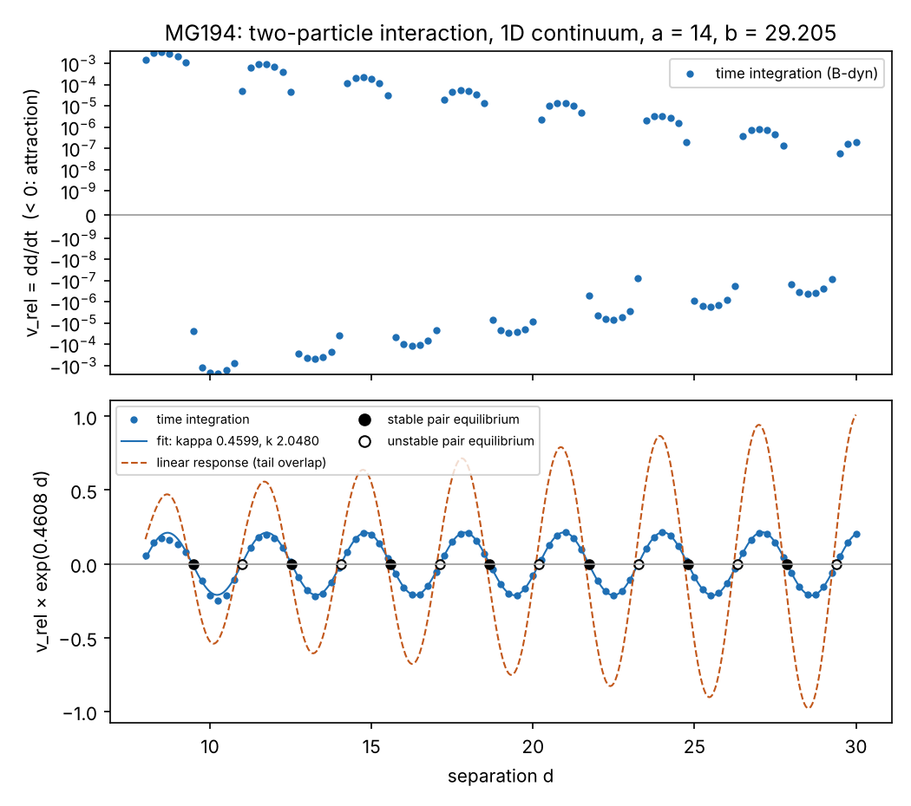

# MG194 results: gravity drift confirmation and two-particle interaction (continuum 1D)

**Outcome.**
- **Part A: CONFIRMED.** A particle drifts toward lower G at the speed linear response predicts, within 3.3%, from four
  new starting points.
- **Part B: OSCILLATORY, decay law SUPPORTED.** Two particles do not simply attract. The force between them changes sign
  every 1.53 units of separation and shrinks by e^(−0.460 d). That is exactly the decay rate and wavelength of the
  particle's own tails. There is a ladder of stable pair separations spaced one tail wavelength (3.07) apart. The
  registered predictions held for both parts.

**What this means for the programme.**
- SQK's gravity drift is solid in the 1D continuum Model G equations at a robust operating point. The earlier failures
  (MG191, MG192 P2) were caused by mesh pinning and by the published b = 29 sitting at the edge of the existence
  window, not by the physics.
- In this model, the particle–particle force is not gravity-like. It is the short-range, sign-alternating interaction
  of Turing-type solitons, set entirely by the oscillating tails. Pairs lock at preferred spacings, rather like atoms in
  a molecule, and do not fall together.
- This fits MG001's zero G integral: a particle carries no net G monopole. In 1D the G field is also screened anyway.
  So a 1D model cannot produce a long-range attraction between particles. The drift down an imposed gradient is real,
  but particles do not generate a long-range gradient for each other.
- **Limits.** 1D continuum only, one operating point, deterministic. Whether 3D Model G particles have a non-screened
  far field, which SQK needs for gravity, is untested. Study 3 in the gravity plan (far-field monopole in 2D/3D) is the
  natural test.

Specification: `spec/MG194_two_particle_gravity.md`, registered and frozen at `0a48c327` before computation. PI approval:
Richard Benear, 2026-11-16 11:48 America/Denver ("yes", adopting D1–D4). Design, implementation, run and report:
Claude.

## Part A: gravity drift at (a, b) = (14, 29.20526)

**A0 numerics: PASS.**
- Stationary residual 4.2e-12.
- The adjoint gives μ_a = −0.0551286. The separate continuation method gives −0.0551286 at κ = 1e-4 and at κ = 2e-4,
  agreeing to 6e-8 and 2e-7 relative (limit 1e-3).
- Null speeds 1.7e-16 and 1.2e-16 (limit 1e-12).

**A1: PASS. Part A is CONFIRMED.** Source a(x) = 14(1 + ε sin 2πx/100), ε = 0.002 unless stated.

| ε | x₀ | Predicted v | Measured v | Relative error | Largest depth change |
| ---: | ---: | ---: | ---: | ---: | ---: |
| 0.002 | +6.25 | −8.9605e-05 | −8.9873e-05 | +0.30% | 1.5% |
| 0.002 | −6.25 | −8.9605e-05 | −8.8115e-05 | −1.66% | 1.0% |
| 0.002 | +18.75 | −3.7115e-05 | −3.7753e-05 | +1.72% | 2.9% |
| 0.002 | −18.75 | −3.7115e-05 | −3.5911e-05 | −3.24% | 2.2% |
| 0.001 | +18.75 | −1.8558e-05 | −1.8651e-05 | +0.50% | 1.3% |
| 0 | +6.25, +18.75 | 0 | 1.7e-16, −1.2e-16 | null | 0.3% |

- The limits were 10% on speed and 5% on depth. No particle dissolved.
- As in EX001, particles on the high-a side drift slightly faster and those on the low-a side slightly slower. This
  is the second-order effect of the mobility depending on the local a.
- The speed ratio between ε = 0.002 and ε = 0.001 at +18.75 is 2.024.

## Part B: two particles at separation d (L = 100, N = 1024, T = 100)

**B0 numerics: PASS.**
- Single-particle null speed 6.9e-18.
- At d = 30, L = 100 and L = 200 give the same v_rel (2.00118e-07) to about 1e-16, so the periodic domain has no
  effect.
- The resolution floor is 1.9e-15. All 89 separations are resolved, with no merges. At the three closest separations
  (d = 8.25–8.75) the separation changed by up to 0.36 during the run; those runs are flagged as moving and counted.
- All 14 pair-equilibrium Newton solves converged, with residuals ≤ 8.3e-12.

**B1, sign pattern: OSCILLATORY,** as predicted.
- v_rel is positive (repulsive) from d = 8 to 9.49, then alternates sign.
- 14 zeros fall in [8, 30]: 9.495, 10.985, 12.537, 14.063, 15.601, 17.132, 18.665, 20.196, 21.727, 23.259, 24.797,
  26.332, 27.865 and 29.397.
- Gaps between zeros run from 1.491 to 1.551 (mean 1.531). All are within the registered 1.533 ± 25%, and all but the
  first are within 1.2%.
- Attraction and repulsion alternate: the pair is pulled together in (9.49, 10.99), (12.54, 14.06), (15.60, 17.13),
  and so on, and pushed apart in between.

**B2, decay law: SUPPORTED.**
- The weighted fit gives κ = 0.45987, 0.20% below the predicted 0.46082, and k = 2.04804, 0.05% below the predicted
  2.04914. The limits were 10% and 5%. Weighted relative RMS residual 6.8%.

**B3, linear response (reported).** The tail-overlap formula places the zeros within about 0.10 of the measured ones,
always slightly lower. Its amplitude is wrong, however. It overestimates the force by about 2.2 times at d ≈ 8, growing
to about 4.6 times at d ≈ 30, and the median relative error is 250%. In the lower panel of the figure, its envelope
grows with d while the measured one is flat. My reading, not checked: the formula's integrand is not localized near
the particle, because the product of the two tails decays at the same rate as the interaction itself, so this naive
first-order formula picks up a spurious factor that grows with d. The correct weak-interaction theory needs more care.
Nothing scored depends on it.

**B4, exact pair equilibria (reported).** Equilibria sit at every zero, and their d* matches the time-integration zeros
to within 0.005.

| Stable d* | 9.491 | 12.532 | 15.594 | 18.659 | 21.725 | 24.792 | 27.858 |
| --- | --- | --- | --- | --- | --- | --- | --- |
| **Unstable d*** | **10.985** | **14.057** | **17.125** | **20.192** | **23.258** | **26.325** | **29.391** |

- Stable and unstable equilibria alternate.
- Consecutive stable separations are 3.04–3.07 apart, one tail wavelength.
- The deciding (relative-mode) eigenvalue falls in size from 7.2e-3 at d = 9.49 to 5.7e-7 at d = 29.39, at roughly
  the same e^(−0.46 d) rate. So distant bound pairs are only very weakly held.

**B5, non-oscillating bias (reported).**
- Adding a non-oscillating term C e^(−0.9657 d) to the fit gives C/amplitude = −4.5, so the extra component is
  attractive. It decays twice as fast as the oscillating part.
- It amounts to about 8% of the oscillating amplitude at d = 8, and under 0.3% beyond d = 15.
- It barely improves the fit: the residual goes from 6.8% to 6.3%. So it is weakly determined.
- There may be a small short-range attractive bias, but nothing long-range.

## Separate recomputation

`src/mg194_check.py` re-fits every speed from the saved trajectories with its own least-squares code, and recomputes
the floor, the resolved set, the zeros, A1 and the decay law by different estimators: k from the mean zero spacing,
and κ from a log-linear fit to the peak |v_rel| of each half-wavelength.

| Quantity | Driver | Check |
| --- | ---: | ---: |
| Largest speed difference | — | 1.4e-16 |
| A1 | PASS | PASS (same errors) |
| Zeros | 14 | 14, identical |
| k | 2.04804 | 2.05205 |
| κ | 0.45987 | 0.46053 |

Both estimators fall within the B2 limits. The check shares the trajectories, results.json and NumPy with the driver.
It is same-author work, not external replication.

## Deviations

None in scoring. Part B's merge check ("fewer than two separate cores") was coded as cores closer than 2.0 or a core
depth above −1. No run came near either condition: the closest final separation was 8.14 and the shallowest final core
depth −9.47.

## Resources and records

- **Compute:** Claude's cloud container, 4 processes, wall time 1159 s. About 1 core-hour, against the 3 core-hour
  cap, estimated from per-run times (2450 core-s for the dynamics) plus the serial and equilibrium parts.
- **Platform:** Linux x86_64, Python 3.13.18, NumPy 2.5.3, SciPy 1.18.1.
- **Code:** `src/mg194_two_particle.py`, `src/mg194_check.py` and `src/mg194_figure.py`, reusing
  `src/mg192_mobility.py` and `src/mg192_check.py`.
- **Records:** `results.json`, `check.json`, `run_log.txt`, `trajectories.npz`, `soliton_bstar*.npz`,
  `adjoint_bstar.npz` and `pair_eq_*.npz` (the 14 equilibrium states). Figure:
  `paper/figures/MG194_two_particle.png`.

**PI CLOSED 2026-11-16** (Richard Benear, 12:32 America/Denver: "I approve closure.").
